# DocuMind — 문서 대상 맞춤 최적화 · 개인 기여 포트폴리오

문서를 독자의 수준에 맞게 재작성하고, 생성·평가 LLM을 나눈 Actor-Critic 흐름으로 결과를 점검하는 3인 팀 프로젝트입니다. 이 README는 프로젝트 구조와 제가 구현·고도화한 범위를 코드·커밋·화면으로 정리합니다.

[원본 팀 저장소](https://github.com/Bjs-coder-kr/AIPOC) · [개인 포트폴리오 저장소](https://github.com/gmkoo-d3v/AIPOC) · [구현 검토 기록](docs/diagram-review.md)

| 구분 | 내용 |
|---|---|
| 주요 기능 | 문서 품질 분석, 대상 맞춤 최적화, 문서 Q&A, 안티테제, 데이터 탐색·내보내기 |
| 개인 역할 | Actor-Critic 대화형 제어·최고 결과 복원, Best Practice 검색·provider 분리, DB 탐색기·결과 내보내기 |
| 기본 스택 | Python · Streamlit · ChromaDB · SQLite |
| 주요 라이브러리 | LangChain · rank_bm25 · pypdf · python-docx · reportlab |
| 생성·평가 연동 | Gemini CLI/API · Claude CLI/API · OpenAI API · Codex CLI |
| 임베딩 연동 | OpenAI · Gemini · Ollama |

## 1. 내 역할과 구현 근거

### 문서 대상 맞춤 최적화

`public / student / worker / expert` 네 가지 대상에 맞춰 문서 표현·어휘·난이도를 조정하는 기능을 고도화했습니다. 주 LLM(생성)과 보조 LLM(평가)을 별도로 선택할 수 있고, 평가 결과에 따라 수락·재시도·자동 진행을 제어합니다. Best Practice 검색으로 참고 예시를 제공하고 추가 개선 중 점수가 하락하면 최고 결과로 복원합니다.

초기 Actor-Critic 생성·평가 루프는 팀의 기존 구현입니다. 제 기여는 상태 모델·generator 기반 제어·사용자 결정·복원과 검색 연결의 확장입니다.

| 개인 기여 | 근거 커밋 |
|---|---|
| `OptimizerState`, generator, 사용자 수락·재시도, 추가 개선·최고 결과 복원, 최적화 세션 연결 | [76aaf60](https://github.com/gmkoo-d3v/AIPOC/commit/76aaf60) |
| 수락·1회 재시도·끝까지 자동 진행의 3버튼 UI와 `auto_run` 처리 | [30f4f66](https://github.com/gmkoo-d3v/AIPOC/commit/30f4f66) |
| Best Practice 저장·Hybrid 검색 및 provider별 컬렉션 분리 | [76aaf60](https://github.com/gmkoo-d3v/AIPOC/commit/76aaf60), [4d1ba9a](https://github.com/gmkoo-d3v/AIPOC/commit/4d1ba9a) |

초기 구현과의 경계는 [423020e](https://github.com/gmkoo-d3v/AIPOC/commit/423020e)에서 확인할 수 있습니다. 현재 구현: [TargetOptimizer](documind/target_optimizer/optimizer.py), [Actor-Critic](documind/actor_critic/orchestrator.py).

### ChromaDB 탐색기와 provider별 저장 분리

컬렉션 조회, 문서·메타데이터 상세 확인, Best Practice의 TXT/PDF 내보내기를 연결했습니다. 최적화 참고 예시는 임베딩 provider별 컬렉션에 저장하고, 탐색기에서 provider를 바꾸면 대응하는 컬렉션을 조회합니다. 조회 실패나 대상 조건에 맞는 후보가 없는 경우의 검색 경로도 보완했습니다.

관련 커밋: [a3c48b1](https://github.com/gmkoo-d3v/AIPOC/commit/a3c48b1), [b013cc3](https://github.com/gmkoo-d3v/AIPOC/commit/b013cc3), [4d1ba9a](https://github.com/gmkoo-d3v/AIPOC/commit/4d1ba9a), [4d78fab](https://github.com/gmkoo-d3v/AIPOC/commit/4d78fab). 현재 구현: [탐색기 UI](documind/app/views/analy_app.py), [Best Practice Manager](documind/utils/best_practice_manager.py).

### SQLite 이력·사용자 조회와 결과 내보내기

분석 이력, 결과 상세, 관리자용 사용자 목록을 조회하는 화면을 구성했습니다. 일반 사용자는 자기 이력을, 관리자는 전체 이력을 조회하며, 재작성 결과가 있는 최적화 이력에서는 TXT/PDF 다운로드를 제공합니다. TXT에 UTF-8 BOM을 적용하고 PDF의 한글 폰트 로딩을 보완했습니다.

관련 커밋: [a3c48b1](https://github.com/gmkoo-d3v/AIPOC/commit/a3c48b1), [aaf29f8](https://github.com/gmkoo-d3v/AIPOC/commit/aaf29f8), [5446707](https://github.com/gmkoo-d3v/AIPOC/commit/5446707), [58f7f41](https://github.com/gmkoo-d3v/AIPOC/commit/58f7f41), [8326a08](https://github.com/gmkoo-d3v/AIPOC/commit/8326a08). 현재 구현: [SQLite 저장소](documind/utils/db.py), [내보내기](documind/utils/export.py).

소스 패키지·저장소 구조 정리에도 참여했습니다: [f66c715](https://github.com/gmkoo-d3v/AIPOC/commit/f66c715), [412d0e0](https://github.com/gmkoo-d3v/AIPOC/commit/412d0e0), [5ea4f6f](https://github.com/gmkoo-d3v/AIPOC/commit/5ea4f6f), [48b17d1](https://github.com/gmkoo-d3v/AIPOC/commit/48b17d1).

## 2. 시스템 구조

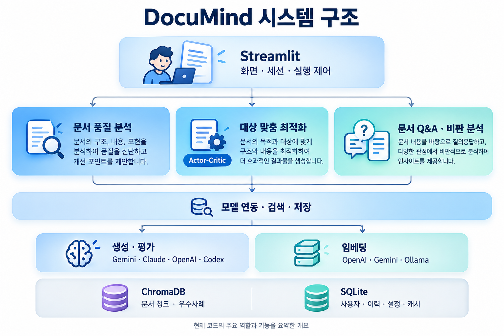

[상세 구조 PUML](docs/diagrams/architecture.puml) · [상세 PNG](docs/diagrams/architecture.png) · **[슬라이드용 간소화 구조도](docs/diagrams/architecture-slide.png)** · [슬라이드 PUML](docs/diagrams/architecture-slide.puml)

UI와 Application 실행 제어는 현재 `app/views/analy_app.py`에 함께 있습니다. 이 파일이 기능 모듈과 DB 탐색·이력·출력을 연결합니다. 생성·평가 제공자와 임베딩 제공자는 구분하며, 안티테제에는 LangChain을 통한 모델 직접 호출 경로가 있습니다. 두 구조도는 같은 구현을 서로 다른 상세도로 표현합니다.

<details>
<summary>구현 구조를 자세히 보기: PlantUML</summary>


기능 인포그래픽은 주요 역할을 요약합니다. 직접 호출·공통 지원·저장 경로는 위 구조도와 소스에서 확인할 수 있습니다.

</details>

<details>
<summary>사용자 기능 전체: 유즈케이스 다이어그램</summary>


[PUML 원본](docs/diagrams/use-cases.puml). 문서 기능은 로그인·업로드 후 이용합니다. 관리자에게는 전체 이력·RAG 문서와 사용자 목록 조회가 추가됩니다.

</details>

## 3. 최적화 동작과 설계 선택

### 같은 문서, 독자에 맞는 표현

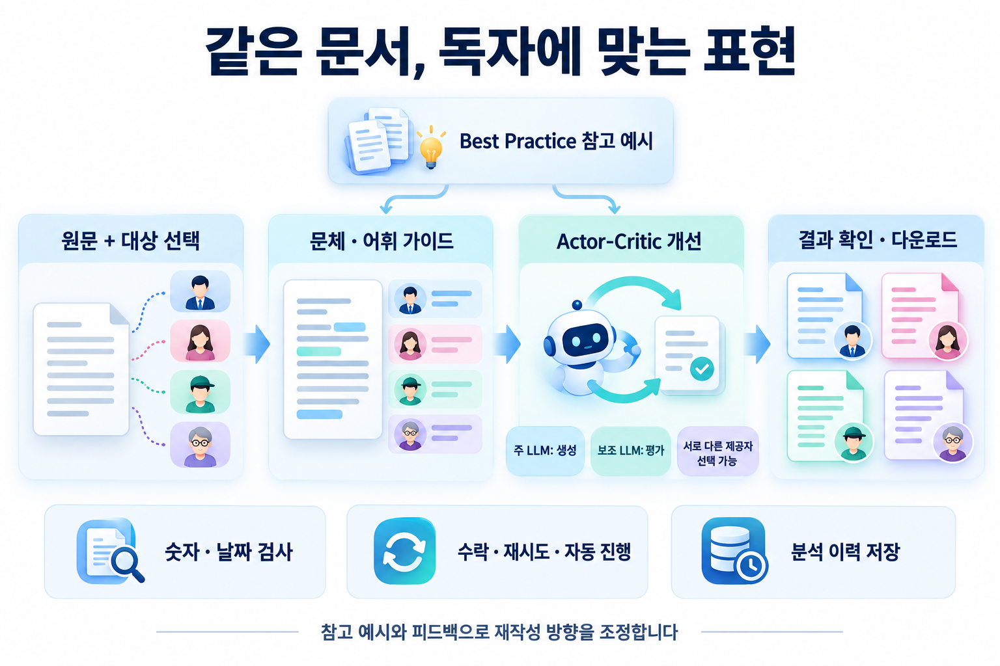

원문과 대상 선택에서 시작해 가이드·참고 예시·Actor-Critic 개선·결과 확인으로 이어집니다. 숫자·날짜 검사와 사용자 결정, 이력 저장을 함께 연결합니다. 검사 생략·fallback 등 세부 동작은 아래 PlantUML 참조도에 표시했습니다.

### 네 가지 독자에 맞춘 페르소나

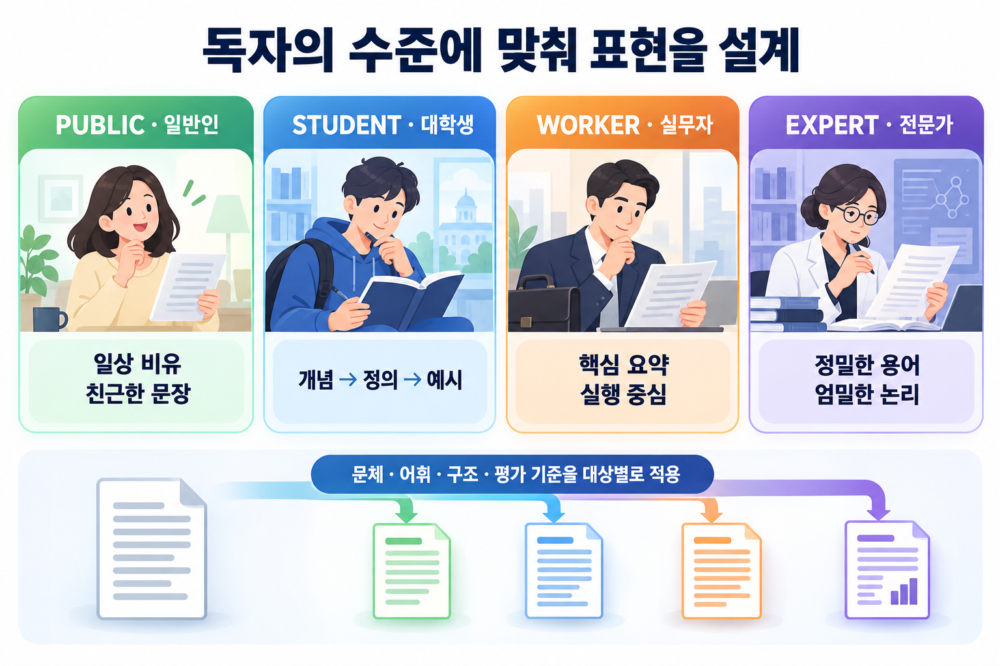

일반인은 친근한 문장과 비유, 대학생은 개념·정의·예시, 실무자는 실행 중심 요약, 전문가는 정밀한 용어와 논리에 초점을 둡니다.

### Actor-Critic 검증과 사용자 결정

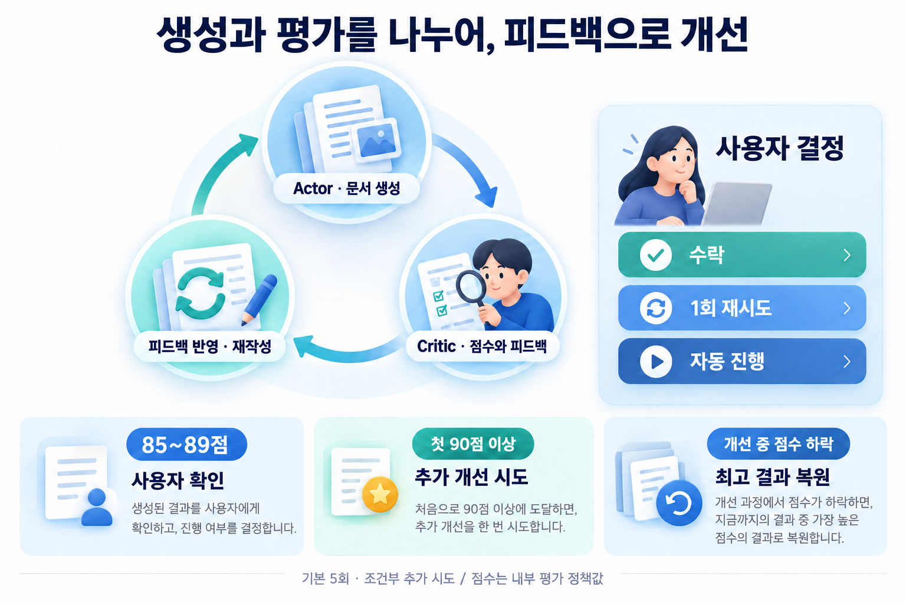

생성 모델과 평가 모델을 분리해 피드백 기반 개선을 수행합니다. 기본 설정은 5회 시도, 85~89점 사용자 확인, 90점 이상 통과 기준입니다. 최초 통과 기준 도달 후에는 추가 개선을 시도하며, 조건에 따라 시도 한도가 연장될 수 있습니다. 추가 개선에서 점수가 하락하면 최고 결과로 복원합니다. 따라서 “최대 5회” 또는 “90점 이상 즉시 종료”로 설명하지 않습니다.

[PUML](docs/diagrams/actor-critic.puml) · [PNG](docs/diagrams/actor-critic.png) · [구현 코드](documind/actor_critic/orchestrator.py)

<details>
<summary>Actor-Critic의 상세 분기·종료 경로</summary>

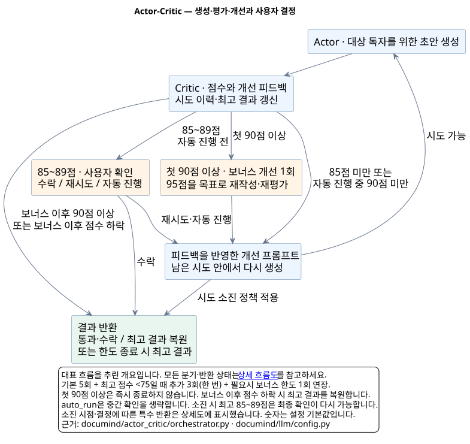

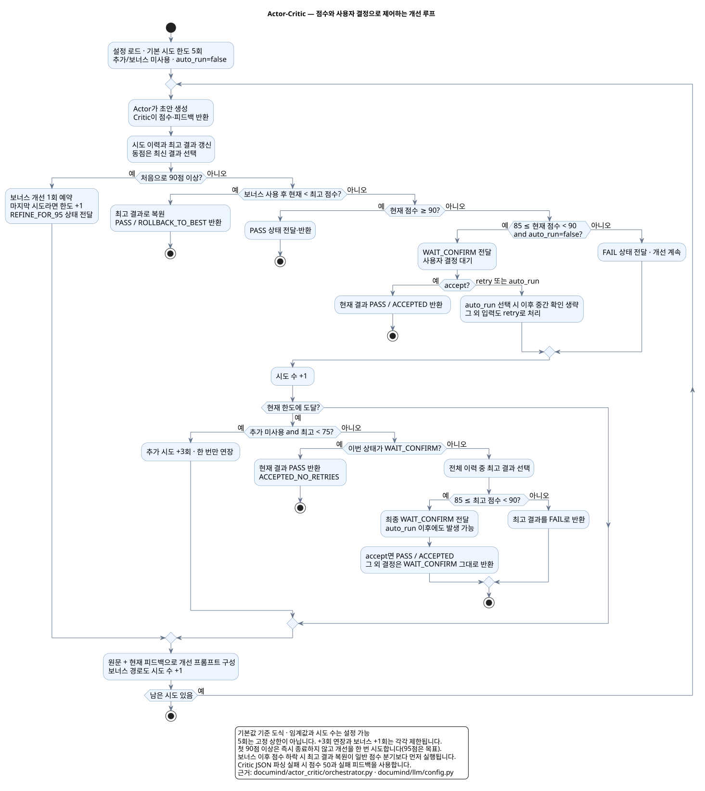

[PUML](docs/diagrams/actor-critic-detail.puml) · [PNG](docs/diagrams/actor-critic-detail.png). 마지막 시도의 사용자 확인과 재시도 한도 소진 후 동작까지 표시한 구현 참조용 그림입니다.

</details>

<details>
<summary>대상 맞춤 최적화 전체 파이프라인</summary>

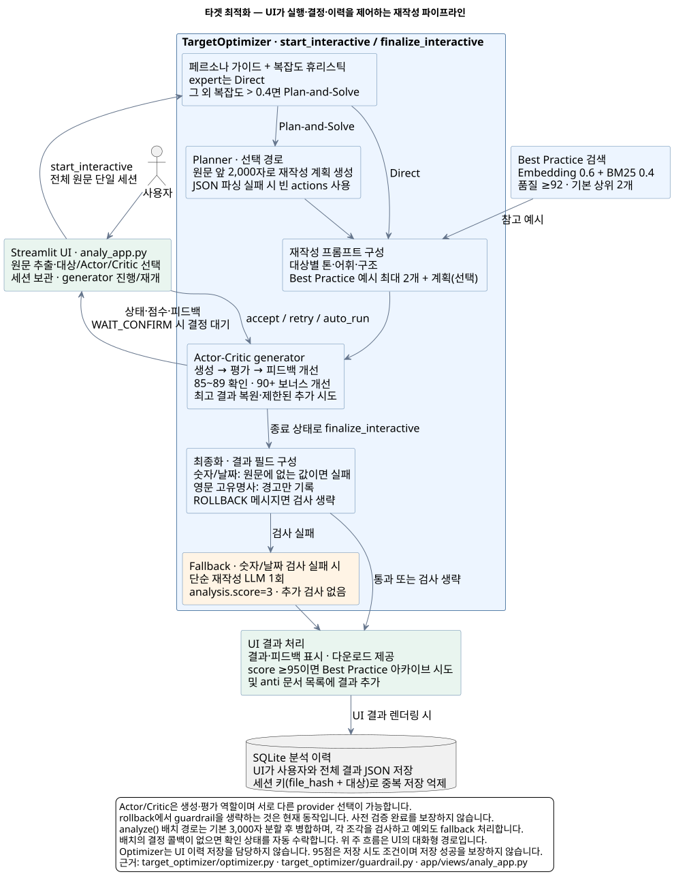

[PUML](docs/diagrams/target-optimization.puml) · [PNG](docs/diagrams/target-optimization.png). UI가 사용자 결정·세션·이력 저장을 조정하고, Optimizer가 페르소나·참고 예시·생성·검사를 연결합니다. 그림에는 현재 fallback과 검사를 생략하는 경로도 표시했습니다.

</details>

### Best Practice Hybrid 검색

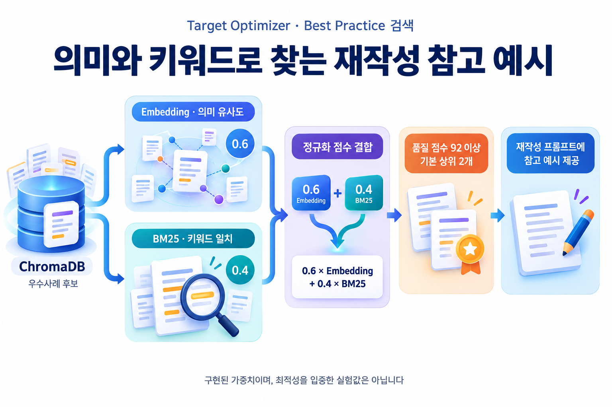

최적화 참고 예시를 검색할 때 정규화한 임베딩 유사도와 BM25 점수를 `0.6 × Embedding + 0.4 × BM25`로 결합합니다. 의미 유사도와 키워드 일치를 함께 반영하며, 기본적으로 품질 점수 92 이상 후보에서 상위 2개를 사용합니다. 이 가중치는 구현값이며 비교 실험으로 검증된 최적값은 `[uncertain]`입니다. 적용 범위는 Target Optimizer의 우수사례 검색입니다.

[PUML](docs/diagrams/hybrid-search.puml) · [PNG](docs/diagrams/hybrid-search.png) · [검색 코드](documind/utils/best_practice_manager.py)

### 임베딩 provider별 우수사례 저장

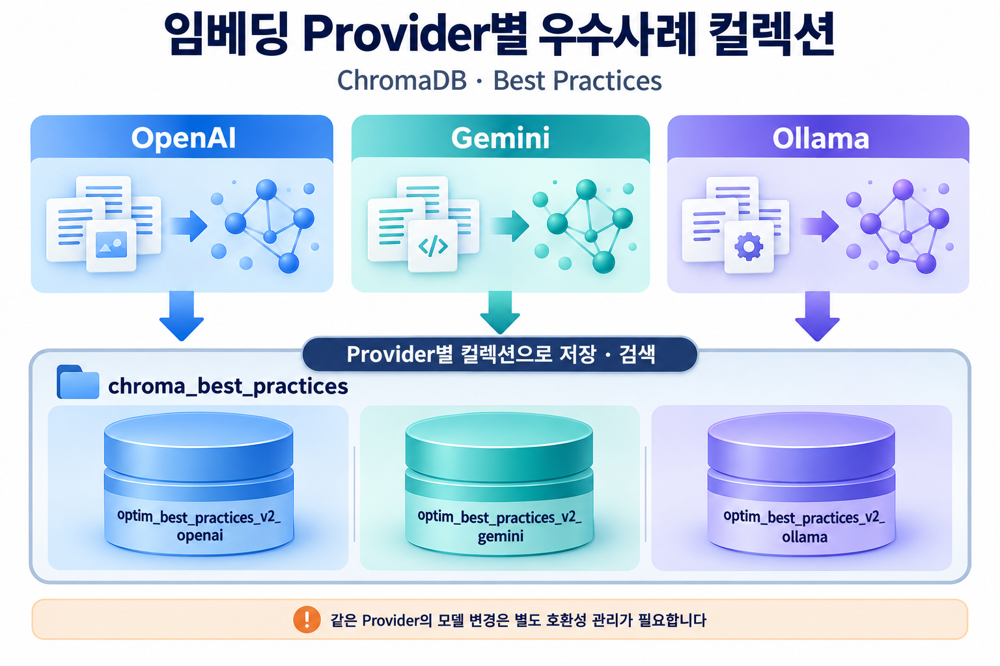

OpenAI·Gemini·Ollama의 임베딩을 각 Best Practice 컬렉션으로 분리해 저장·검색합니다. 같은 provider 안에서 모델을 변경하는 경우의 호환성은 별도로 관리해야 합니다.

<details>
<summary>임베딩 provider별 저장 구조와 4개 페르소나</summary>

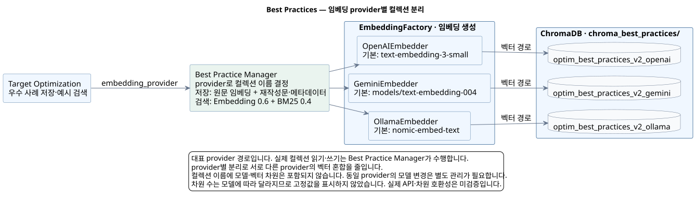

Best Practice 컬렉션은 `optim_best_practices_v2_openai / gemini / ollama`로 분리합니다. 모델·차원은 컬렉션 이름에 포함되지 않으므로 같은 provider에서 임베딩 모델을 바꾸는 경우에는 별도 관리가 필요합니다. 차원 수는 모델·설정에 따라 달라져 고정 수치로 표시하지 않았습니다.

[PUML](docs/diagrams/provider-isolation.puml) · [PNG](docs/diagrams/provider-isolation.png)

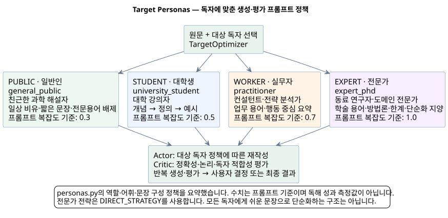

대상에 맞는 문체·어휘·구조를 생성·평가 프롬프트에 반영합니다. 전문가는 정밀한 용어와 논리를 유지하는 정책입니다. 모든 대상을 무조건 쉽게 요약하는 방식으로 설명하지 않습니다.

[PUML](docs/diagrams/personas.puml) · [PNG](docs/diagrams/personas.png) · [페르소나 정의](documind/target_optimizer/personas.py)

</details>

## 4. 화면으로 보는 구현

사용자가 제공한 `img/1`의 화면 5장을 저장소 안으로 정리했습니다. RAG·Best Practice 화면은 기존 시연 데이터를 조회한 캡처이며, 표시된 점수는 당시 저장된 내부 평가값입니다. 이번 문서 작업에서 외부 모델을 새로 호출하거나 성능을 재측정하지 않았습니다.

### 문서 대상 맞춤 최적화 — 생성·평가 모델 선택

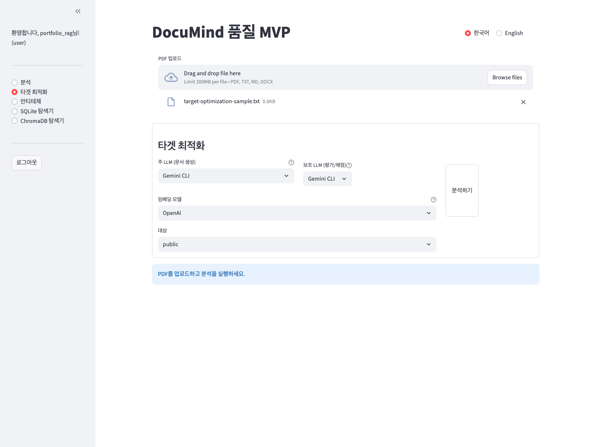

네 가지 페르소나와 생성·평가 LLM, 임베딩 provider를 선택하는 화면입니다. 캡처에서는 두 LLM이 모두 Gemini CLI로 선택되어 있습니다. 서로 다른 제공자를 고르는 기능은 [설정 UI](documind/app/views/analy_app.py)와 [Actor-Critic 코드](documind/actor_critic/orchestrator.py)에서 확인할 수 있습니다. 이 사진은 설정 화면을 보여줍니다.

### ChromaDB 탐색기 — provider별 Best Practice 조회

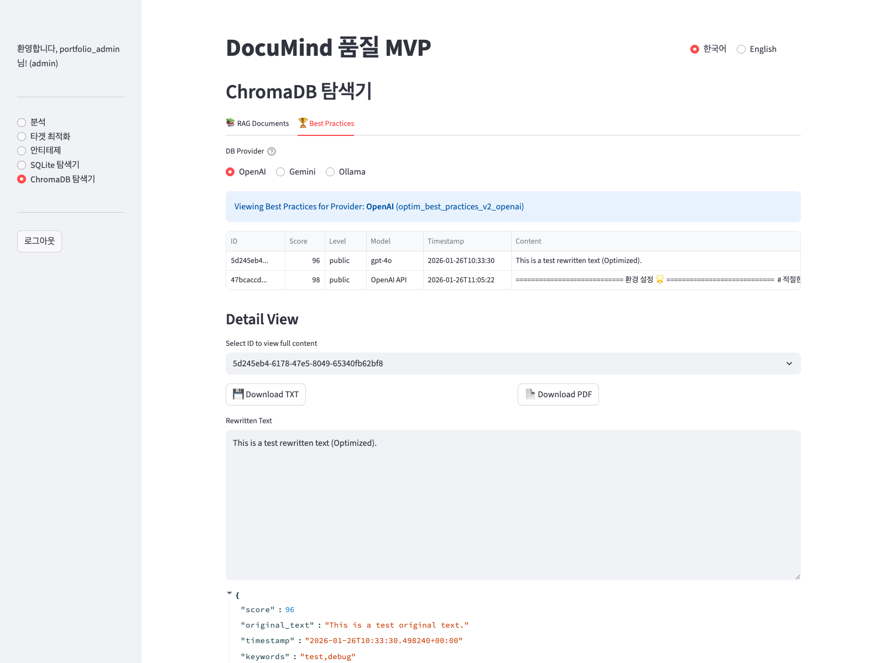

OpenAI / Gemini / Ollama 선택에 따라 Best Practice 컬렉션을 전환합니다. 저장 문서와 메타데이터를 확인하고, 상세 결과를 TXT/PDF로 내보내는 UI입니다. 캡처의 `test` 문구·키워드는 기존 테스트 데이터이므로 실제 문서 최적화 성과로 해석하지 않습니다.

### ChromaDB 탐색기 — 사용자별 RAG 문서 조회

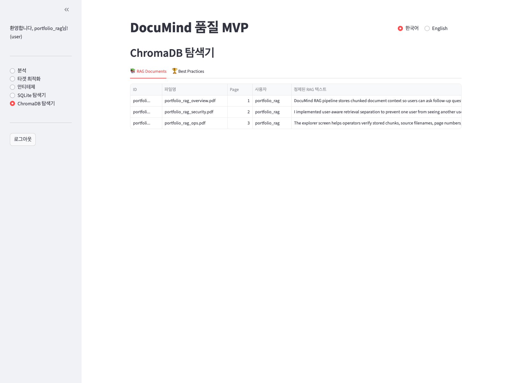

벡터 저장소에 들어 있는 문서 청크와 파일명·페이지·사용자 메타데이터를 함께 확인합니다. 탐색기는 일반 사용자에게 `user_id == username` 필터를 적용하고 관리자는 전체를 조회합니다. 이 화면은 문서·메타데이터 조회 UI를 보여주며, 수치 벡터 자체를 표시하는 화면은 아닙니다. [권한 분기 구현](documind/app/views/analy_app.py).

### SQLite 탐색기 — 분석 이력과 결과 상세

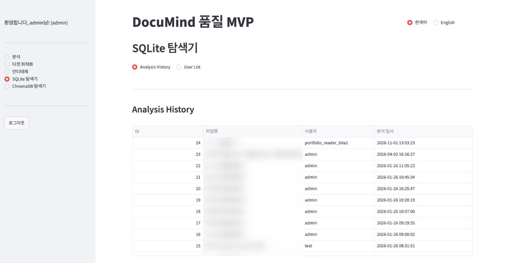

관리자 화면에서 분석 이력의 ID·사용자·일시를 조회합니다. 공개용 이미지에서는 파일명 열의 블러를 유지하고, 상세 JSON에 남아 있던 파일명은 촬영 범위에서 제외했습니다. 원본 DB는 변경하지 않았습니다. 재작성 결과가 있는 최적화 이력에서는 결과 상세와 TXT/PDF 다운로드를 제공합니다.

<details>
<summary>보조 화면: 관리자 사용자 목록</summary>

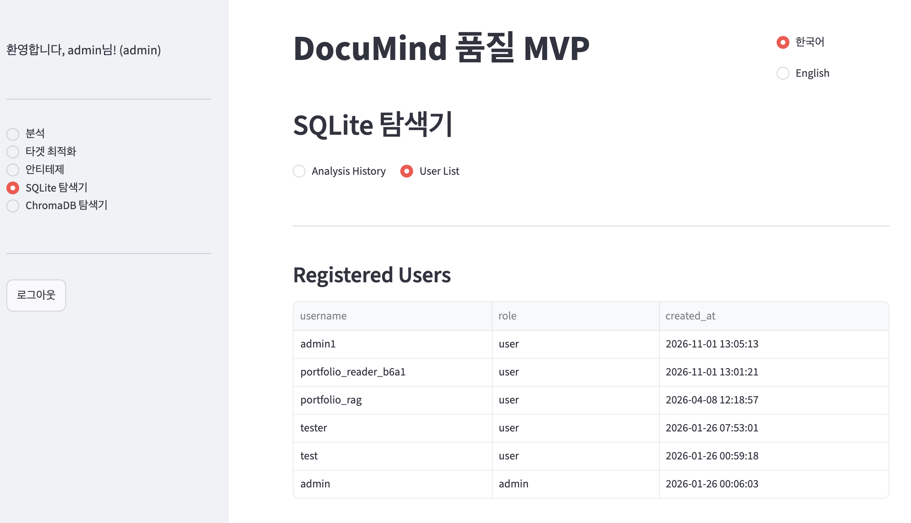

사용자·역할·가입 일시를 확인하는 관리자용 화면입니다. 대표 기능 화면은 위의 최적화·ChromaDB·분석 이력으로 구성하고, 계정 목록은 보조 자료로 둡니다.

</details>

[캡처 출처와 가공 범위](docs/screens/README.md)

## 5. 실행 방법 — uv

`.python-version`은 Python 3.11을 지정합니다. 의존성은 기존 `requirements.txt`를 사용하며, 버전 잠금 파일은 없습니다. 시스템에 uv가 준비된 환경에서 실행합니다.

```bash
uv venv --python 3.11
uv pip install --python .venv/bin/python -r requirements.txt
uv run --no-project --python .venv/bin/python streamlit run documind/app/main.py
```

기본 접속 주소는 `http://localhost:8501`입니다. 회원가입·로그인 후 문서를 업로드합니다. 규칙 기반 분석에는 외부 모델이 필요하지 않습니다. 현재 앱에는 AI 확장 토글과 별개로 API 키를 감지해 합의 진단을 시도하는 경로가 있으므로, 외부 호출 없이 시연할 때는 키를 전달하지 않고 실행합니다.

```bash
env -u OPENAI_API_KEY -u GEMINI_API_KEY -u ANTHROPIC_API_KEY \
  .venv/bin/python -m streamlit run documind/app/main.py \
  --server.address 127.0.0.1 --server.port 8501 --server.headless true
```

AI 기능을 사용할 때는 선택한 API의 키 또는 CLI 인증·실행 환경을 준비합니다. OpenAI는 `OPENAI_API_KEY`, Gemini는 `GEMINI_API_KEY`, Claude API는 `ANTHROPIC_API_KEY`를 사용합니다. Ollama 임베딩에는 로컬 Ollama와 해당 모델이, OCR에는 Tesseract가 필요합니다. [전체 의존성](requirements.txt) · [모델 설정](documind/llm/config.py) · [시연용 문서](docs/samples/)

## 6. 검증과 한계

```bash
PYTHONPATH=. .venv/bin/python -m pytest \
  --confcutdir=documind/tests --import-mode=importlib \
  documind/tests/test_loaders.py documind/tests/test_db_embeddings.py -q
```

위 수집 옵션은 저장소 최상위 `__init__.py`의 패키지 import 문제를 피하기 위한 것입니다. 로더·SQLite·캐시 테스트 9개는 Python 3.12 환경에서 통과했습니다. 환경 의존 검증은 별도로 실행합니다. `test_optim_rag.py`는 로컬 임베딩·ChromaDB 환경을 필요로 하며, 단독으로 검색 적중률 개선을 입증하는 테스트는 아닙니다.

```bash
PYTHONPATH=. .venv/bin/python -m pytest \
  --confcutdir=documind/tests --import-mode=importlib \
  documind/tests/test_optim_rag.py -q
```

- Critic의 85/90점, 우수사례 저장 기준 95점은 내부 정책값입니다. 실측 정확도·사용자 만족도와 구분합니다.
- 순수 임베딩 대비 적중률·응답 시간 개선은 비교 측정 결과를 확인하지 못했으며 `[uncertain]`입니다.
- provider별 컬렉션 분리는 구현되어 있습니다. 동일 provider 안의 모델 변경·벡터 차원 호환성은 별도 검증 대상입니다.
- 일반 사용자 이력 필터, RAG 탐색기 필터, Q&A 검색 범위는 각각의 경로에서 확인해야 합니다. 전체 접근 통제를 한 장의 화면으로 검증했다고 주장하지 않습니다.

## 7. 다이어그램 원본과 재생성

본문의 **기능 인포그래픽 6종**은 코드와 대조한 문구를 바탕으로 새로 생성한 설명용 이미지입니다. [인포그래픽 목록과 설명 범위](docs/infographics/README.md)를 제공합니다. 실제 앱 화면은 별도의 스크린샷이며, 인포그래픽을 실행 결과나 성능 측정 자료로 사용하지 않습니다.

상세 구현 참조도는 PlantUML 원본에서 SVG·PNG로 렌더링했습니다. 슬라이드용 간소화 구조도도 함께 제공합니다. 아래 명령은 이 PlantUML 참조도를 다시 생성합니다.

```bash
# plantuml.jar는 준비한 PlantUML JAR 경로로 변경합니다.
java -Djava.awt.headless=true -Djava.awt.fonts=assets/fonts \
  -jar plantuml.jar -charset UTF-8 -checkonly 'docs/diagrams/*.puml'
java -Djava.awt.headless=true -Djava.awt.fonts=assets/fonts \
  -jar plantuml.jar -charset UTF-8 -tsvg 'docs/diagrams/*.puml'
java -Djava.awt.headless=true -Djava.awt.fonts=assets/fonts \
  -jar plantuml.jar -charset UTF-8 -tpng 'docs/diagrams/*.puml'
```

한글 렌더링에는 저장소의 NanumGothic 폰트를 사용합니다. Smetana 레이아웃을 사용하므로 별도 Graphviz 설치가 필요하지 않습니다. [기존 이미지 검토와 수정 근거](docs/diagram-review.md)
