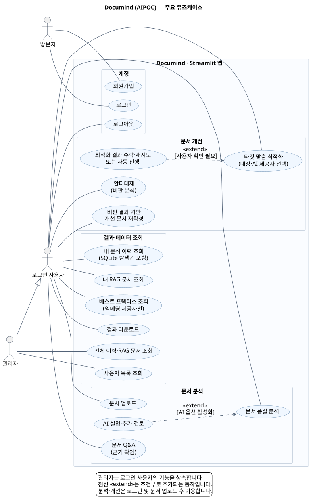
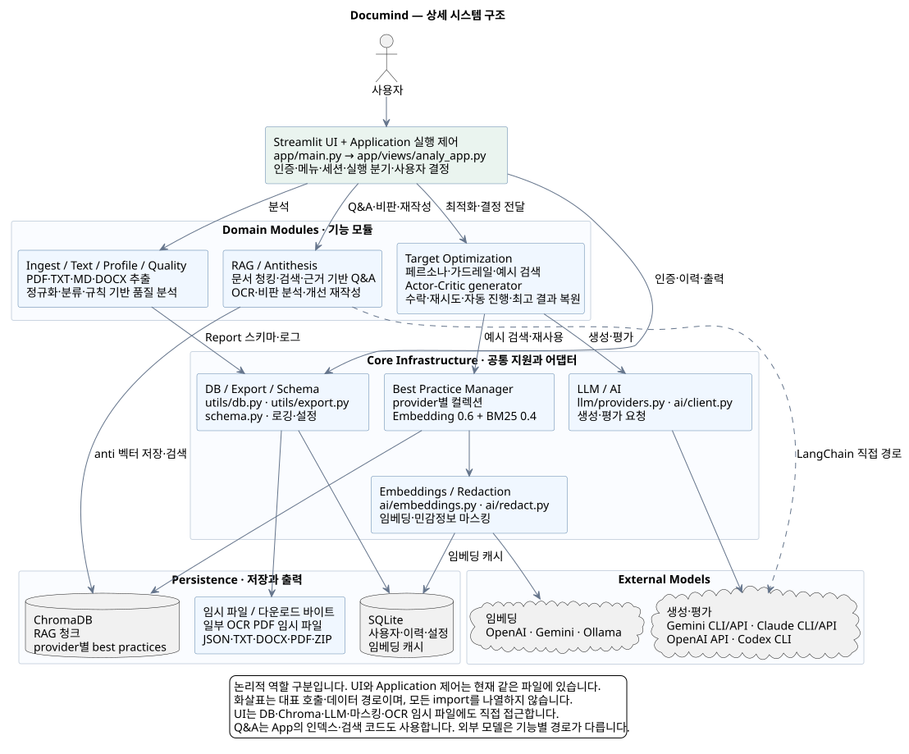

# Documind (AIPOC) - 개인 기여 포트폴리오

> 이 문서는 팀 프로젝트 전체 소개가 아니라, 제가 직접 설계하고 구현한 범위만 정리한 README입니다.

## 1. 프로젝트 개요
- 원본 저장소: [Bjs-coder-kr/AIPOC](https://github.com/Bjs-coder-kr/AIPOC)
- 프로젝트 성격: 문서 분석 및 최적화 POC
- 팀 구성: 3인
- 기술 스택: Python, Streamlit, LangChain, ChromaDB, SQLite, rank_bm25, pypdf, python-docx, reportlab
- 생성·평가 제공자: Gemini CLI/API, Claude CLI/API, OpenAI API, Codex CLI
- 임베딩 제공자: OpenAI, Gemini, Ollama (생성·평가 제공자와 별도 설정)
- 핵심 기능: PDF 분석, 품질 평가, RAG 검색, 타깃 맞춤 리라이팅(Actor-Critic), 결과 내보내기
- 기여 방식: 담당 기능을 독립 구현 후 팀 레포에 통합 및 안정화

## 유즈케이스 다이어그램

아래는 개인 기여 범위를 구분하는 다이어그램이 아니라, 현재 `main`의 Streamlit 앱에서 제공하는 주요 사용자 기능입니다.



[PlantUML 원본](docs/diagrams/use-cases.puml) · [SVG 크게 보기](docs/diagrams/use-cases.svg)

- 방문자: 회원가입·로그인. 문서 기능은 로그인 후 이용합니다.
- 로그인 사용자: 문서 업로드, 품질 분석, 문서 Q&A, 타깃 최적화, 안티테제 및 개선 재작성, 결과 다운로드, 자기 이력·RAG 문서와 베스트 프랙티스 조회.
- 관리자: 일반 사용자 기능에 더해 전체 이력·RAG 문서 및 사용자 목록 조회. SQLite/ChromaDB 탐색기 자체는 일반 사용자도 이용할 수 있습니다.
- 선행 조건: 분석·개선할 문서를 먼저 업로드합니다. 업로드 UI는 PDF/TXT/MD/DOCX를 허용하지만 처리 가능 여부는 모드·파일 내용·OCR 환경에 따라 달라집니다. 개선 재작성에는 먼저 생성한 비판 결과가 필요합니다.
- 조건부 동작: AI 설명·추가 검토는 AI 옵션 활성화 시, 최적화 수락·재시도·자동 진행은 사용자 확인이 필요한 경우에 제공됩니다. `<<extend>>`는 이 조건부 동작을 뜻하며 실행 순서를 나타내지 않습니다.
- AI 및 다운로드: AI 기능에는 해당 제공자의 실행 환경·인증 설정이 필요합니다. 다운로드 형식은 화면별로 다르며 분석 리포트는 JSON, 최적화 결과는 TXT/DOCX/PDF/ZIP, 안티테제 결과는 TXT/DOCX/PDF/JSON을 제공합니다.
- 범위: 구현된 주요 사용자 목표만 표시합니다. 내부 DB·검색 엔진은 액터로 취급하지 않으며, 별도 운영자 역할이나 새 기능은 추가하지 않습니다.

구현 근거: [화면·로그인·권한 분기](documind/app/views/analy_app.py), [타깃 최적화](documind/target_optimizer/optimizer.py), [Actor-Critic](documind/actor_critic/orchestrator.py), [비판·재작성 체인](documind/anti/rag/chain.py), [이력·사용자 저장소](documind/utils/db.py).

GitHub에서 바로 볼 수 있도록 렌더링된 SVG를 함께 저장합니다. `.puml`을 수정했다면 PlantUML과 한글 폰트(NanumGothic)를 사용할 수 있는 환경에서 SVG도 다시 생성합니다. 아래 명령의 `plantuml.jar`는 준비한 PlantUML JAR 경로로 바꿉니다. Smetana 레이아웃을 사용하므로 Graphviz는 별도로 필요하지 않습니다.

```bash
java -Djava.awt.headless=true -Djava.awt.fonts=assets/fonts -jar plantuml.jar -charset UTF-8 -checkonly docs/diagrams/use-cases.puml
java -Djava.awt.headless=true -Djava.awt.fonts=assets/fonts -jar plantuml.jar -charset UTF-8 -tsvg docs/diagrams/use-cases.puml
```

## 아키텍처 다이어그램



[PlantUML 원본](docs/diagrams/architecture.puml) · [SVG 크게 보기](docs/diagrams/architecture.svg)

`Streamlit → Application → Domain Modules → Core → External Models`는 현재 코드를 역할별로 구분한 논리적 구조입니다. Application의 실행·세션 조정은 현재 `app/views/analy_app.py`에 UI와 함께 구현되어 있습니다. UI의 인증·DB 탐색·내보내기 직접 호출과 `anti`의 LangChain 모델 호출은 점선으로 표시했습니다. Core에는 공통 스키마와 외부 서비스 어댑터가 포함됩니다.

생성·평가 경로는 [`llm/providers.py`](documind/llm/providers.py), 임베딩 경로는 [`ai/embeddings.py`](documind/ai/embeddings.py), 제공자 목록은 [`llm/config.py`](documind/llm/config.py)에서 확인할 수 있습니다. Claude CLI/API 호출은 구현되어 있고, Ollama는 임베딩 제공자로 사용합니다. 제공자별 실행·인증 환경은 별도로 필요하며, 이 문서 변경에서 외부 모델 호출 성공 여부는 검증하지 않았습니다.

```bash
java -Djava.awt.headless=true -Djava.awt.fonts=assets/fonts -jar plantuml.jar -charset UTF-8 -checkonly docs/diagrams/architecture.puml
java -Djava.awt.headless=true -Djava.awt.fonts=assets/fonts -jar plantuml.jar -charset UTF-8 -tsvg docs/diagrams/architecture.puml
```

## 2. 기여 목표
1. ChromaDB 컬렉션 미존재 및 조회 실패 상황에서도 사용자 흐름이 불필요하게 중단되지 않도록 검색 경로의 안정성을 향상.
2. 멀티 임베딩 프로바이더 환경에서 데이터 혼합으로 인한 검색 품질 저하를 방지.
3. 개발자/시연 운영자가 데이터 상태와 사용자 이력을 빠르게 확인할 수 있도록 가시성을 강화.
4. 분석 결과를 즉시 검토하고 공유할 수 있도록 내보내기 기능과 한글 호환성을 개선.
5. Actor-Critic 루프를 대화형으로 고도화해 사용자 수락·재시도·자동 진행과 최고 결과 복원을 연결.

## 3. 주요 기여 내용

### A. ChromaDB 조회 안정성 및 RAG 검색 경로 개선
- 배경: ChromaDB 컬렉션 미존재, 조회 실패, provider별 임베딩 혼합 가능성으로 인해 검색 결과의 안정성이 떨어질 수 있었다.
- 기여:
  - ChromaDB best-practice 조회 시 target_level 조건 결과가 없으면 전체 컬렉션 재조회로 완화.
  - ChromaDB 조회 예외가 전체 최적화 흐름으로 전파되지 않도록 fail-soft 흐름을 적용.
  - 기존 문서 Q&A/RAG 구조와 분리해, Target Optimizer의 best-practice 검색을 embedding similarity(0.6) + BM25(0.4) 기반 hybrid retrieval로 고도화.
- 기대 효과:
  - 검색 저장소 상태가 불완전한 경우에도 사용자 플로우가 즉시 중단되는 리스크 감소
  - 단순 벡터 유사도만 사용하는 방식보다 키워드 일치 신호를 함께 반영할 수 있도록 검색 품질 개선 여지를 확보.
- 관련 커밋: [76aaf60](https://github.com/gmkoo-d3v/AIPOC/commit/76aaf60), [4d1ba9a](https://github.com/gmkoo-d3v/AIPOC/commit/4d1ba9a)

### B. 멀티 프로바이더 데이터 분리
- 배경: 임베딩 프로바이더마다 벡터 차원과 특성이 다른데 동일 저장소를 공유하면 데이터 오염과 검색 품질 저하 가능성이 있었다.
- 기여:
  - 프로바이더별 ChromaDB 컬렉션 및 저장 흐름을 분리.
  - UI 탐색기에서 provider 선택 기반 조회를 지원하도록 개선.
  - OpenAI, Gemini, Ollama 임베딩 provider 선택값을 설정으로 관리하도록 구성.
- 기대 효과:
  - 프로바이더 간 데이터 혼합 리스크를 줄이고 검색 결과의 일관성 유지.
- 관련 커밋: [4d1ba9a](https://github.com/gmkoo-d3v/AIPOC/commit/4d1ba9a)

### C. 운영 가시성 기능 강화
- 배경: 개발자/시연 운영자가 사용자별 이력과 DB 상태를 직접 확인하기 어려워 장애 분석과 시연 대응에 시간이 오래 걸릴 수 있었다.
- 기여:
  - 사이드바 메뉴 구조를 정리.
  - SQLite/ChromaDB 탐색기와 사용자/이력 조회 UI를 정리·연결.
  - ChromaDB Explorer에서 RAG 문서와 best-practice 데이터를 구분해 확인할 수 있도록 구성.
- 기대 효과:
  - 데이터 저장 상태를 빠르게 파악하고 원인 추적 시간을 줄일 수 있도록 지원.
- 관련 커밋: [b013cc3](https://github.com/gmkoo-d3v/AIPOC/commit/b013cc3), [f66c715](https://github.com/gmkoo-d3v/AIPOC/commit/f66c715), [4d78fab](https://github.com/gmkoo-d3v/AIPOC/commit/4d78fab), [aaf29f8](https://github.com/gmkoo-d3v/AIPOC/commit/aaf29f8)

### D. 결과 내보내기 및 한글 호환성 개선
- 배경: 분석 결과를 외부에 공유하려면 별도 가공이 필요했고, TXT/PDF 내보내기 시 한글 깨짐 이슈가 있었다.
- 기여:
  - 히스토리, 베스트 프랙티스, SQLite 탐색기 화면에서 TXT/PDF 내보내기를 연결.
  - TXT는 UTF-8 BOM을 적용하고, PDF는 `TTFont` 로딩을 보완해 한글 호환성을 개선.
  - 최적화 결과 화면에서는 TXT, DOCX, PDF, ZIP 다운로드를 지원.
- 기대 효과:
  - 분석 결과를 바로 공유 가능한 파일 형태로 내려받을 수 있게 되었고, 한글 출력 호환성을 개선.
- 관련 커밋: [4d78fab](https://github.com/gmkoo-d3v/AIPOC/commit/4d78fab), [aaf29f8](https://github.com/gmkoo-d3v/AIPOC/commit/aaf29f8), [5446707](https://github.com/gmkoo-d3v/AIPOC/commit/5446707), [58f7f41](https://github.com/gmkoo-d3v/AIPOC/commit/58f7f41), [8326a08](https://github.com/gmkoo-d3v/AIPOC/commit/8326a08)

### E. 협업 / 구조 개선
- 배경: 중첩 저장소와 불안정한 디렉터리 구조로 인해 개발 및 협업 흐름이 매끄럽지 않았다.
- 기여:
  - 소스 구조를 `documind` 패키지 중심으로 정리.
  - `.gitignore`를 정비하고 불필요한 추적 파일을 정리.
- 기대 효과:
  - 개발 환경의 일관성을 높이고 협업 중 충돌 가능성을 줄였다.
- 관련 커밋: [f66c715](https://github.com/gmkoo-d3v/AIPOC/commit/f66c715), [412d0e0](https://github.com/gmkoo-d3v/AIPOC/commit/412d0e0), [5ea4f6f](https://github.com/gmkoo-d3v/AIPOC/commit/5ea4f6f), [48b17d1](https://github.com/gmkoo-d3v/AIPOC/commit/48b17d1)

### F. Actor-Critic 검증 루프 고도화 및 사용자 의사결정 흐름 구현
- 구현 범위: 기존 Actor-Critic 생성·평가 루프에 상태 모델, 대화형 실행 제어, 사용자 수락·재시도·자동 진행을 추가했습니다.
- [76aaf60](https://github.com/gmkoo-d3v/AIPOC/commit/76aaf60): `OptimizerState`와 generator 기반 상태 전달, 점수 구간별 `WAIT_CONFIRM`, `accept`/`retry` 처리, 추가 개선 후 점수가 하락하면 최고 결과로 복원하는 로직, Target Optimizer 및 Streamlit 세션 연결을 구현했습니다.
- [30f4f66](https://github.com/gmkoo-d3v/AIPOC/commit/30f4f66): `auto_run` 결정과 수락·1회 재시도·끝까지 자동 진행의 3버튼 UI를 추가했습니다.
- 동작 기준: 기본 설정상 90점 이상 통과, 85~89점에서 사용자 확인을 요청합니다. 이는 Critic 모델의 내부 평가 점수이며 실제 정확도나 사용자 만족도 측정값과는 구분합니다.
- 기여 경계: 초기 생성→평가→재작성 및 Best-of-N 루프는 이전 팀 커밋 [423020e](https://github.com/gmkoo-d3v/AIPOC/commit/423020e)에 이미 있습니다. 개인 기여는 위의 상태 기반 제어·복원·대화형 흐름 고도화입니다.
- 관련 커밋: [76aaf60](https://github.com/gmkoo-d3v/AIPOC/commit/76aaf60), [30f4f66](https://github.com/gmkoo-d3v/AIPOC/commit/30f4f66); 초기 구현 확인: [423020e](https://github.com/gmkoo-d3v/AIPOC/commit/423020e).

## 4. 주로 기여한 코드 영역
- `documind/app/views/analy_app.py`
- `documind/utils/export.py`
- `documind/utils/best_practice_manager.py`
- `documind/target_optimizer/optimizer.py`
- `documind/actor_critic/orchestrator.py`
- `documind/llm/config.py`
- `documind/ai/embeddings.py`
- `documind/utils/db.py`

## 5. 검증 관점
- ChromaDB 컬렉션 미존재/조회 실패 상황에서 예외가 사용자 플로우 전체로 전파되지 않는지 확인
- 프로바이더 분리 저장 및 조회가 일관되게 유지되는지 확인
- 탐색기 기능에서 데이터 조회 및 다운로드가 정상 동작하는지 확인
- 한글 TXT/PDF 출력이 깨지지 않고 정상 렌더링되는지 확인
- best-practice 검색 결과가 provider/target_level 조건에 맞게 반환되는지 확인

### 수치와 검증 범위
- Hybrid 검색은 정규화한 embedding similarity 0.6 + BM25 0.4로 결합합니다. 의미 유사도에 더 큰 비중을 두면서 키워드 일치도 반영하는 가중치입니다.
- 이번에 확인한 구현·테스트·평가 스크립트에서 순수 임베딩 대비 적중률이나 이 가중치를 선정한 비교 실험 결과를 확인하지 못했습니다. 0.6/0.4의 최적성·검색 성능 개선율은 `[uncertain]`이며 실측 성과로 주장하지 않습니다.
- Actor-Critic의 85/90점과 best-practice 저장 기준 95점은 내부 정책값입니다. 모델 품질 개선율이나 서비스 성능 수치로 해석하지 않습니다.
- 발표 스택에도 LangChain을 포함하고, AI 항목은 “생성·평가: Gemini/Claude/OpenAI/Codex, 임베딩: OpenAI/Gemini/Ollama”로 구분하면 구현과 일치합니다. 전체 의존성은 [`requirements.txt`](requirements.txt)를 기준으로 확인합니다.

### 참고 테스트 명령
```bash
PYTHONPATH=. pytest documind/tests/test_loaders.py documind/tests/test_db_embeddings.py -q
```

환경 의존 기능까지 확인할 때는 아래 테스트를 추가로 실행합니다. 로컬 Ollama, ChromaDB 저장 상태, API 키 설정에 따라 결과가 달라질 수 있습니다.

```bash
PYTHONPATH=. pytest documind/tests/test_optim_rag.py -q
PYTHONPATH=. pytest documind/tests/test_eval_cases.py -q
```

## 6. 실행 방법 (Quick Start)

### 실행 환경
- Python `3.10 ~ 3.12` 권장
- Streamlit 기반 로컬 실행
- 기본 실행 엔트리포인트: `documind/app/main.py`

### 1) 가상환경 생성
```bash
python3 -m venv .venv
source .venv/bin/activate
```

Windows PowerShell:

```powershell
python -m venv .venv
.venv\Scripts\Activate.ps1
```

### 2) 의존성 설치
```bash
pip install --upgrade pip
pip install -r requirements.txt
```

### 3) 환경 변수 설정
환경 변수는 실행 전 shell에 직접 export하거나 배포 환경의 환경 변수로 설정합니다.

macOS/Linux:

```bash
export OPENAI_API_KEY="your-openai-api-key"
export OPENAI_MODEL="gpt-4o-mini"

# Optional
export GEMINI_API_KEY=""
export ANTHROPIC_API_KEY=""
export DEFAULT_EMBEDDING_PROVIDER="OpenAI"
```

Windows PowerShell:

```powershell
$env:OPENAI_API_KEY="your-openai-api-key"
$env:OPENAI_MODEL="gpt-4o-mini"

# Optional
$env:GEMINI_API_KEY=""
$env:ANTHROPIC_API_KEY=""
$env:DEFAULT_EMBEDDING_PROVIDER="OpenAI"
```

- `OPENAI_API_KEY`: AI 설명, Q&A, OpenAI 임베딩 경로 사용 시 필요
- `OPENAI_MODEL`: OpenAI 기반 Q&A/설명 생성 모델 선택값
- `GEMINI_API_KEY`: Gemini API 사용 시 필요
- `ANTHROPIC_API_KEY`: Claude API 사용 시 필요
- `DEFAULT_EMBEDDING_PROVIDER`: 기본 임베딩 제공자 선택값(`OpenAI`, `Gemini`, `Ollama`)

### 4) 앱 실행
```bash
streamlit run documind/app/main.py
```

Windows PowerShell에서는 아래 스크립트로도 실행할 수 있습니다.

```powershell
./scripts/demo_run.ps1
```

실행 후 기본 접속 주소:

```text
http://localhost:8501
```

### 5) 포트폴리오 시연 추천 순서
1. `sample_pdfs/` 안의 예시 PDF 하나를 업로드
2. `분석` 메뉴에서 품질 점검 결과 확인
3. `타겟 최적화` 메뉴에서 대상별 리라이팅 확인
4. `SQLite 탐색기`와 `ChromaDB 탐색기`에서 저장 상태 확인
5. TXT/PDF 내보내기로 결과 공유 포맷 확인

### 6) 선택 의존성
- OCR 기반 PDF Q&A 기능까지 확인하려면 시스템에 `Tesseract` 설치가 필요합니다.
- 로컬 임베딩 경로를 쓰려면 `Ollama`가 실행 중이어야 합니다.

### 7) 최소 검증 명령
```bash
PYTHONPATH=. pytest documind/tests/test_loaders.py documind/tests/test_db_embeddings.py -q
```

의존성 설치 후 위 테스트로 로더 경로와 SQLite/embedding cache 경로가 정상 동작하는지 빠르게 확인할 수 있습니다.
